# Modelo entidad–relación V10

Fuente exclusiva: `Backend/prisma/schema.prisma`, mediante Prisma DMMF. Regenerar con `cd Backend && npm run prisma:generate`, luego `node tools/generate-erd.cjs` desde V10. El archivo `database-erd.drawio` es editable en draw.io.

No existe tabla Admin: la cuenta administrativa es configuración del Backend. La deuda real es `MembershipDebt`; las alertas son `BusinessAlert`. `MembershipNumberCounter` asigna números. `FuelAuthorization` registra reserva y despacho; `Transaction` conserva precio y datos fiscales. `Payment`, `RewardMovement` y `WalletMovement` conservan los libros de pagos, puntos y saldo. `PasswordReset` guarda hashes, intentos y fechas, nunca códigos en claro.

En el diagrama, `||` significa uno obligatorio, `o|` cero o uno y `o{` cero o muchos. Una FK única limita la relación inversa a cero o uno. Un campo escalar sin `@relation` no se transforma en relación: por ejemplo `WalletMovement.transactionId` y `BusinessAlert.operationId` son referencias de operación, no FK.

```mermaid
erDiagram
  User {
    String id PK "required"
    String email UK "required"
    String name "required"
    String passwordHash "required"
    Boolean active "required"
    Int authVersion "required"
    DateTime createdAt "required"
    DateTime updatedAt "required"
  }
  MembershipNumberCounter {
    Int id PK "required"
    BigInt value "required"
  }
  Membership {
    String id PK "required"
    String number UK "required"
    String userId FK,UK "required"
    MembershipStatus status "required"
    Decimal balance "required"
    String passport UK "nullable"
    String dni UK "nullable"
    String ruc UK "nullable"
    String businessName "nullable"
    DateTime createdAt "required"
    DateTime updatedAt "required"
  }
  User ||--o| Membership : "userId"
  Vehicle {
    String id PK "required"
    String plate UK "required"
    String label "required"
    String membershipId FK "nullable"
    DateTime createdAt "required"
    DateTime updatedAt "required"
  }
  Membership |o--o{ Vehicle : "membershipId"
  Station {
    String id PK "required"
    String code UK "required"
    String name "required"
    String address "required"
    Boolean active "required"
    DateTime createdAt "required"
    DateTime updatedAt "required"
  }
  Fuel {
    String id PK "required"
    String code UK "required"
    String name "required"
    Decimal pricePerGallon "required"
    Boolean active "required"
    DateTime createdAt "required"
    DateTime updatedAt "required"
  }
  Transaction {
    String id PK "required"
    String operationId UK "required"
    String requestHash "required"
    String plate "required"
    String vehicleId FK "nullable"
    String membershipCode "nullable"
    String membershipId FK "nullable"
    String stationId FK "required"
    String fuelId FK "required"
    Decimal amount "required"
    String currency "required"
    Decimal unitPrice "required"
    Decimal gallons "nullable"
    Decimal solesPerPoint "nullable"
    Decimal pointsRate "required"
    Int pointsEarned "required"
    PurchaseMode mode "required"
    ReceiptType receiptType "required"
    TransactionStatus status "required"
    String receiptDni "nullable"
    String receiptRuc "nullable"
    String receiptBusinessName "nullable"
    String authorizationId FK,UK "nullable"
    DateTime createdAt "required"
    DateTime updatedAt "required"
  }
  Vehicle |o--o{ Transaction : "vehicleId"
  Membership |o--o{ Transaction : "membershipId"
  Station ||--o{ Transaction : "stationId"
  Fuel ||--o{ Transaction : "fuelId"
  FuelAuthorization |o--o| Transaction : "authorizationId"
  FuelAuthorization {
    String id PK "required"
    String operationId UK "required"
    String requestHash "required"
    String membershipId FK "nullable"
    String plate "required"
    String vehicleId FK "nullable"
    String stationId FK "required"
    String fuelId FK "required"
    Decimal unitPrice "nullable"
    String paymentId FK,UK "nullable"
    String interventionReason "nullable"
    Decimal authorizedAmount "required"
    Decimal reservedAmount "required"
    Decimal consumedAmount "nullable"
    Decimal releasedAmount "required"
    Decimal balanceAfter "required"
    Decimal dispensedAmount "required"
    Decimal dispensedGallons "required"
    PurchaseMode mode "required"
    AuthorizationStatus status "required"
    AuthorizationOutcome outcome "nullable"
    DateTime createdAt "required"
    DateTime updatedAt "required"
  }
  Membership |o--o{ FuelAuthorization : "membershipId"
  Vehicle |o--o{ FuelAuthorization : "vehicleId"
  Station ||--o{ FuelAuthorization : "stationId"
  Fuel ||--o{ FuelAuthorization : "fuelId"
  Payment |o--o| FuelAuthorization : "paymentId"
  WalletMovement {
    String id PK "required"
    String membershipId FK "nullable"
    String debtId FK "nullable"
    WalletMovementKind kind "required"
    Decimal amount "required"
    Decimal balanceAfter "required"
    String operationId "nullable"
    String authorizationId FK "nullable"
    String transactionId "nullable"
    String note "nullable"
    DateTime createdAt "required"
  }
  Membership |o--o{ WalletMovement : "membershipId"
  MembershipDebt |o--o{ WalletMovement : "debtId"
  FuelAuthorization |o--o{ WalletMovement : "authorizationId"
  Payment {
    String id PK "required"
    String operationId UK "nullable"
    String requestHash "nullable"
    Decimal unitPrice "nullable"
    String transactionId FK,UK "nullable"
    Decimal amount "required"
    PaymentMethod method "required"
    PaymentStatus status "required"
    String provider "required"
    DateTime createdAt "required"
    DateTime updatedAt "required"
  }
  Transaction |o--o| Payment : "transactionId"
  RewardMovement {
    String id PK "required"
    String membershipId FK "required"
    RewardKind kind "required"
    Int points "required"
    String transactionId FK,UK "nullable"
    String redemptionId FK,UK "nullable"
    DateTime createdAt "required"
  }
  Membership ||--o{ RewardMovement : "membershipId"
  Transaction |o--o| RewardMovement : "transactionId"
  Redemption |o--o| RewardMovement : "redemptionId"
  Benefit {
    String id PK "required"
    String code UK "required"
    String title "required"
    String description "required"
    String category "required"
    Int pointsCost "required"
    Boolean active "required"
    DateTime createdAt "required"
    DateTime updatedAt "required"
  }
  Redemption {
    String id PK "required"
    String operationId UK "required"
    String membershipId FK "required"
    String benefitId FK "required"
    Int pointsSpent "required"
    RedemptionStatus status "required"
    DateTime createdAt "required"
    DateTime updatedAt "required"
  }
  Membership ||--o{ Redemption : "membershipId"
  Benefit ||--o{ Redemption : "benefitId"
  MembershipDebt {
    String id PK "required"
    String membershipId FK "required"
    String transactionId FK,UK "required"
    Decimal amountOriginal "required"
    Decimal amountPaid "required"
    Decimal amountPending "required"
    DebtStatus status "required"
    DateTime createdAt "required"
    DateTime updatedAt "required"
    DateTime settledAt "nullable"
  }
  Membership ||--o{ MembershipDebt : "membershipId"
  Transaction ||--o| MembershipDebt : "transactionId"
  PasswordReset {
    String id PK "required"
    String userId FK,UK "required"
    String codeHash "required"
    String tokenHash UK "nullable"
    Int attempts "required"
    DateTime expiresAt "required"
    DateTime verifiedAt "nullable"
    DateTime usedAt "nullable"
    DateTime createdAt "required"
  }
  User ||--o| PasswordReset : "userId"
  BusinessAlert {
    String id PK "required"
    String eventKey UK "required"
    AlertType type "required"
    AlertStatus status "required"
    String plate "required"
    String[] expectedPlates "required"
    String userName "required"
    String description "required"
    String operationId "required"
    String membershipId FK "required"
    String transactionId FK "nullable"
    String debtId FK "nullable"
    Decimal amountPending "nullable"
    DateTime occurredAt "required"
    DateTime createdAt "required"
    DateTime resolvedAt "nullable"
    String resolvedBy "nullable"
  }
  Membership ||--o{ BusinessAlert : "membershipId"
  Transaction |o--o{ BusinessAlert : "transactionId"
  MembershipDebt |o--o{ BusinessAlert : "debtId"
```

## Claves, relaciones y campos

### User

| Campo | Tipo | Clave / relación |
|---|---|---|
| id | String | PK  |
| email | String | UNIQUE  |
| name | String |  |
| passwordHash | String |  |
| active | Boolean |  |
| authVersion | Int |  |
| passwordReset | PasswordReset? | Relación inversa |
| membership | Membership? | Relación inversa |
| createdAt | DateTime |  |
| updatedAt | DateTime |  |

### MembershipNumberCounter

| Campo | Tipo | Clave / relación |
|---|---|---|
| id | Int | PK  |
| value | BigInt |  |

### Membership

| Campo | Tipo | Clave / relación |
|---|---|---|
| alerts | BusinessAlert[] | Relación inversa |
| id | String | PK  |
| number | String | UNIQUE  |
| userId | String | UNIQUE  |
| user | User | FK userId → User.id |
| status | MembershipStatus |  |
| balance | Decimal |  |
| passport | String? | UNIQUE  |
| dni | String? | UNIQUE  |
| ruc | String? | UNIQUE  |
| businessName | String? |  |
| debts | MembershipDebt[] | Relación inversa |
| vehicles | Vehicle[] | Relación inversa |
| transactions | Transaction[] | Relación inversa |
| movements | RewardMovement[] | Relación inversa |
| redemptions | Redemption[] | Relación inversa |
| authorizations | FuelAuthorization[] | Relación inversa |
| walletMovements | WalletMovement[] | Relación inversa |
| createdAt | DateTime |  |
| updatedAt | DateTime |  |

### Vehicle

| Campo | Tipo | Clave / relación |
|---|---|---|
| id | String | PK  |
| plate | String | UNIQUE  |
| label | String |  |
| membershipId | String? |  |
| membership | Membership? | FK membershipId → Membership.id |
| transactions | Transaction[] | Relación inversa |
| authorizations | FuelAuthorization[] | Relación inversa |
| createdAt | DateTime |  |
| updatedAt | DateTime |  |

### Station

| Campo | Tipo | Clave / relación |
|---|---|---|
| id | String | PK  |
| code | String | UNIQUE  |
| name | String |  |
| address | String |  |
| active | Boolean |  |
| transactions | Transaction[] | Relación inversa |
| authorizations | FuelAuthorization[] | Relación inversa |
| createdAt | DateTime |  |
| updatedAt | DateTime |  |

### Fuel

| Campo | Tipo | Clave / relación |
|---|---|---|
| id | String | PK  |
| code | String | UNIQUE  |
| name | String |  |
| pricePerGallon | Decimal |  |
| active | Boolean |  |
| transactions | Transaction[] | Relación inversa |
| authorizations | FuelAuthorization[] | Relación inversa |
| createdAt | DateTime |  |
| updatedAt | DateTime |  |

### Transaction

| Campo | Tipo | Clave / relación |
|---|---|---|
| alerts | BusinessAlert[] | Relación inversa |
| id | String | PK  |
| operationId | String | UNIQUE  |
| requestHash | String |  |
| plate | String |  |
| vehicleId | String? |  |
| vehicle | Vehicle? | FK vehicleId → Vehicle.id |
| membershipCode | String? |  |
| membershipId | String? |  |
| membership | Membership? | FK membershipId → Membership.id |
| stationId | String |  |
| station | Station | FK stationId → Station.id |
| fuelId | String |  |
| fuel | Fuel | FK fuelId → Fuel.id |
| amount | Decimal |  |
| currency | String |  |
| unitPrice | Decimal |  |
| gallons | Decimal? |  |
| solesPerPoint | Decimal? |  |
| pointsRate | Decimal |  |
| pointsEarned | Int |  |
| mode | PurchaseMode |  |
| receiptType | ReceiptType |  |
| status | TransactionStatus |  |
| receiptDni | String? |  |
| receiptRuc | String? |  |
| receiptBusinessName | String? |  |
| debt | MembershipDebt? | Relación inversa |
| payment | Payment? | Relación inversa |
| rewardMovement | RewardMovement? | Relación inversa |
| authorizationId | String? | UNIQUE  |
| authorization | FuelAuthorization? | FK authorizationId → FuelAuthorization.id |
| createdAt | DateTime |  |
| updatedAt | DateTime |  |

### FuelAuthorization

| Campo | Tipo | Clave / relación |
|---|---|---|
| id | String | PK  |
| operationId | String | UNIQUE  |
| requestHash | String |  |
| membershipId | String? |  |
| membership | Membership? | FK membershipId → Membership.id |
| plate | String |  |
| vehicleId | String? |  |
| vehicle | Vehicle? | FK vehicleId → Vehicle.id |
| stationId | String |  |
| station | Station | FK stationId → Station.id |
| fuelId | String |  |
| fuel | Fuel | FK fuelId → Fuel.id |
| unitPrice | Decimal? |  |
| paymentId | String? | UNIQUE  |
| payment | Payment? | FK paymentId → Payment.id |
| interventionReason | String? |  |
| authorizedAmount | Decimal |  |
| reservedAmount | Decimal |  |
| consumedAmount | Decimal? |  |
| releasedAmount | Decimal |  |
| balanceAfter | Decimal |  |
| dispensedAmount | Decimal |  |
| dispensedGallons | Decimal |  |
| mode | PurchaseMode |  |
| status | AuthorizationStatus |  |
| outcome | AuthorizationOutcome? |  |
| createdAt | DateTime |  |
| updatedAt | DateTime |  |
| transaction | Transaction? | Relación inversa |
| movements | WalletMovement[] | Relación inversa |

### WalletMovement

| Campo | Tipo | Clave / relación |
|---|---|---|
| id | String | PK  |
| membershipId | String? |  |
| membership | Membership? | FK membershipId → Membership.id |
| debtId | String? |  |
| debt | MembershipDebt? | FK debtId → MembershipDebt.id |
| kind | WalletMovementKind |  |
| amount | Decimal |  |
| balanceAfter | Decimal |  |
| operationId | String? |  |
| authorizationId | String? |  |
| authorization | FuelAuthorization? | FK authorizationId → FuelAuthorization.id |
| transactionId | String? |  |
| note | String? |  |
| createdAt | DateTime |  |

UNIQUE compuesto: `operationId, kind`.

### Payment

| Campo | Tipo | Clave / relación |
|---|---|---|
| id | String | PK  |
| operationId | String? | UNIQUE  |
| requestHash | String? |  |
| unitPrice | Decimal? |  |
| authorization | FuelAuthorization? | Relación inversa |
| transactionId | String? | UNIQUE  |
| transaction | Transaction? | FK transactionId → Transaction.id |
| amount | Decimal |  |
| method | PaymentMethod |  |
| status | PaymentStatus |  |
| provider | String |  |
| createdAt | DateTime |  |
| updatedAt | DateTime |  |

### RewardMovement

| Campo | Tipo | Clave / relación |
|---|---|---|
| id | String | PK  |
| membershipId | String |  |
| membership | Membership | FK membershipId → Membership.id |
| kind | RewardKind |  |
| points | Int |  |
| transactionId | String? | UNIQUE  |
| transaction | Transaction? | FK transactionId → Transaction.id |
| redemptionId | String? | UNIQUE  |
| redemption | Redemption? | FK redemptionId → Redemption.id |
| createdAt | DateTime |  |

### Benefit

| Campo | Tipo | Clave / relación |
|---|---|---|
| id | String | PK  |
| code | String | UNIQUE  |
| title | String |  |
| description | String |  |
| category | String |  |
| pointsCost | Int |  |
| active | Boolean |  |
| redemptions | Redemption[] | Relación inversa |
| createdAt | DateTime |  |
| updatedAt | DateTime |  |

### Redemption

| Campo | Tipo | Clave / relación |
|---|---|---|
| id | String | PK  |
| operationId | String | UNIQUE  |
| membershipId | String |  |
| membership | Membership | FK membershipId → Membership.id |
| benefitId | String |  |
| benefit | Benefit | FK benefitId → Benefit.id |
| pointsSpent | Int |  |
| status | RedemptionStatus |  |
| rewardMovement | RewardMovement? | Relación inversa |
| createdAt | DateTime |  |
| updatedAt | DateTime |  |

### MembershipDebt

| Campo | Tipo | Clave / relación |
|---|---|---|
| alerts | BusinessAlert[] | Relación inversa |
| id | String | PK  |
| membershipId | String |  |
| membership | Membership | FK membershipId → Membership.id |
| transactionId | String | UNIQUE  |
| transaction | Transaction | FK transactionId → Transaction.id |
| amountOriginal | Decimal |  |
| amountPaid | Decimal |  |
| amountPending | Decimal |  |
| status | DebtStatus |  |
| createdAt | DateTime |  |
| updatedAt | DateTime |  |
| settledAt | DateTime? |  |
| movements | WalletMovement[] | Relación inversa |

### PasswordReset

| Campo | Tipo | Clave / relación |
|---|---|---|
| id | String | PK  |
| userId | String | UNIQUE  |
| user | User | FK userId → User.id |
| codeHash | String |  |
| tokenHash | String? | UNIQUE  |
| attempts | Int |  |
| expiresAt | DateTime |  |
| verifiedAt | DateTime? |  |
| usedAt | DateTime? |  |
| createdAt | DateTime |  |

### BusinessAlert

| Campo | Tipo | Clave / relación |
|---|---|---|
| id | String | PK  |
| eventKey | String | UNIQUE  |
| type | AlertType |  |
| status | AlertStatus |  |
| plate | String |  |
| expectedPlates | String[] |  |
| userName | String |  |
| description | String |  |
| operationId | String |  |
| membershipId | String |  |
| membership | Membership | FK membershipId → Membership.id |
| transactionId | String? |  |
| transaction | Transaction? | FK transactionId → Transaction.id |
| debtId | String? |  |
| debt | MembershipDebt? | FK debtId → MembershipDebt.id |
| amountPending | Decimal? |  |
| occurredAt | DateTime |  |
| createdAt | DateTime |  |
| resolvedAt | DateTime? |  |
| resolvedBy | String? |  |

